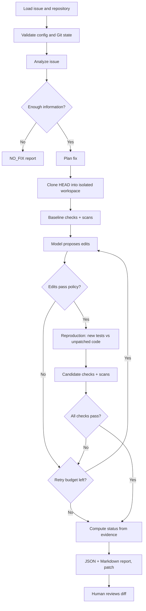

# IssuePilot

**Security-aware, evidence-first AI issue solving — from the command line.**

IssuePilot takes an issue description and a local Git repository, asks a model for a minimal
patch, runs your checks in an isolated workspace, and writes a report that says exactly what was
— and was not — verified.

> An AI issue solver should not just generate a patch. It should understand the problem, make a
> minimal change, verify the result, and clearly report what it could not verify.

**Status: pre-alpha (v0.1.0.dev0).** The local workflow works end to end and is tested; it has
not yet been benchmarked against real-world issues with a real model. See [Limitations](#limitations).

## What makes it different

- **The status is computed, not claimed.** `VERIFIED` requires a test that *failed before* the
  patch and passes after it, every configured check passing, no regressions, no new blocking
  security findings and no weakened tests. The model has no input into that decision.
- **Fail-before / pass-after evidence.** When a patch adds a regression test, IssuePilot runs the
  new test against the *unpatched* code first to prove it actually reproduces the bug.
- **Model output is untrusted.** The model gets no shell and no tools. It returns structured
  edits; the orchestrator rejects path traversal, absolute paths, symlink escapes, writes to
  `.git`, CI workflows and credential files, binary edits and oversized changes.
- **Your working tree is never touched.** Work happens in a private clone of `HEAD` in a temp
  directory; the report records whether your repository was intact afterwards.
- **Fail closed.** If no sandbox is available, repository code is not executed — checks are
  reported as `SKIPPED`, never as passed.
- **Security findings have levels:** `scanner_reported` → `candidate_vulnerability` →
  `reproduced` → `verified_remediation`. A finding is never suppressed because a model said so.

## Quickstart

Requires Python 3.12+, Git, and (for isolated execution) Docker.

```bash
pipx install "issuepilot[anthropic] @ git+https://github.com/devanathsugavasi/issuepilot"
```

```bash
cd your-repo
issuepilot init        # writes issuepilot.yaml (never overwrites)
issuepilot doctor      # checks git, config, provider, sandbox, scanners — changes nothing
```

```bash
export ANTHROPIC_API_KEY=...            # never put keys in issuepilot.yaml
docker pull python:3.12-slim            # IssuePilot never pulls images itself
issuepilot plan --issue issues/bug.md   # read-only analysis + fix plan
issuepilot run  --issue issues/bug.md   # isolated patch + checks + report
```

Example output (from the `idor-dashboard` eval case):

```text
Result: VERIFIED
  - a test failed before the patch and all configured checks pass after it, with no regressions or new blocking findings
Changed files: 2
Checks: 1/1 passed (sandbox: docker (isolated))
Security: 0 new finding(s), 1 total
Report: .issuepilot/runs/<run-id>/report.md
Patch:  .issuepilot/runs/<run-id>/changes.patch
```

Review and apply the patch yourself — IssuePilot never commits, pushes or merges:

```bash
issuepilot diff --run <run-id> | git apply
```

### Try it without an API key or Docker

The repository ships deterministic evaluation cases driven by a scripted fake provider:

```bash
git clone https://github.com/devanathsugavasi/issuepilot && cd issuepilot
uv sync
uv run issuepilot eval evals/cases --sandbox host --trust-repo
```

`--trust-repo` runs the fixture tests on your host **without isolation**; only use it for code you
trust. With Docker available, drop both flags.

## Commands

| Command | What it does | Writes |
|---|---|---|
| `init` | Create a starter `issuepilot.yaml` | config file (only if absent) |
| `doctor` | Validate repo, config, provider, sandbox, scanners | nothing |
| `plan --issue F` | Analyze the issue and propose a plan; no code execution | nothing |
| `run --issue F` | Full workflow in an isolated clone | `.issuepilot/runs/<id>/` |
| `report --run ID` | Show a run's report (`--json` available) | nothing |
| `diff --run ID` | Print or export (`-o`) the candidate patch | optional output file |
| `security` | Run configured scanners on tracked files | nothing |
| `eval [PATH]` | Run benchmark cases and print measured metrics | temp run dirs |

Exit codes: `0` VERIFIED/success · `1` FAILED/error · `2` NEEDS_REVIEW · `3` NO_FIX.

## Run statuses

| Status | Meaning |
|---|---|
| `VERIFIED` | A test failed before the patch, all checks pass after, no regressions, no new blocking findings, no weakened tests |
| `NEEDS_REVIEW` | A valid patch exists but evidence is incomplete — the report lists every reason |
| `NO_FIX` | Not enough information, or no patch passed validation within the retry budget |
| `FAILED` | Execution error (provider, Git, configuration…) — a report is still written |

## How it works



Architecture, threat model and configuration: [docs/](docs/).

## Limitations

Read these before trusting a result:

- Only one real model provider (Anthropic) is implemented. Its adapter is unit-tested with a
  mocked client; it has **not** been benchmarked on real issues yet.
- Context selection is keyword-based and bounded (default 12 files); large or unfamiliar
  codebases may not give the model enough context.
- The Docker backend is the only isolated sandbox. Docker shares the host kernel and is not a
  complete security boundary. Host mode (`--trust-repo`) is **not isolated**.
- Dependency installation inside the sandbox is not supported (network is disabled); your
  configured image must already contain what your checks need.
- Uncommitted changes are deliberately ignored — IssuePilot works from `HEAD`.
- Gitleaks and Semgrep are optional and must be installed separately. The built-in secret scanner
  is regex-based.
- Passing tests and scans never prove the absence of vulnerabilities.
- GitHub automation (issue triggers, draft PRs) is planned, not implemented.

## Contributing

See [CONTRIBUTING.md](CONTRIBUTING.md). Report vulnerabilities privately per [SECURITY.md](SECURITY.md).

## License

[Apache-2.0](LICENSE)
